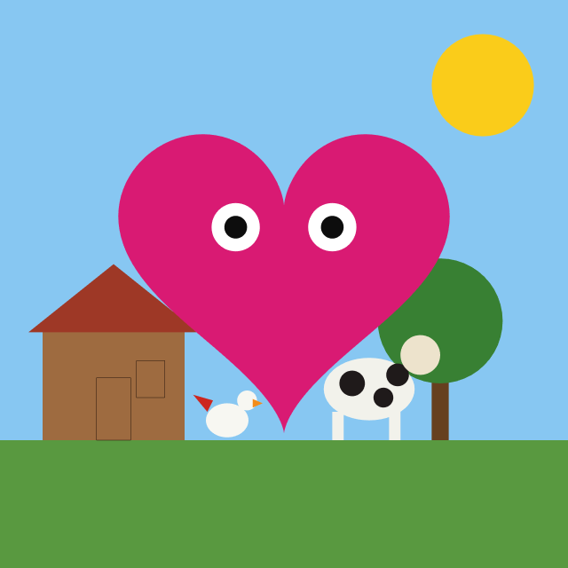
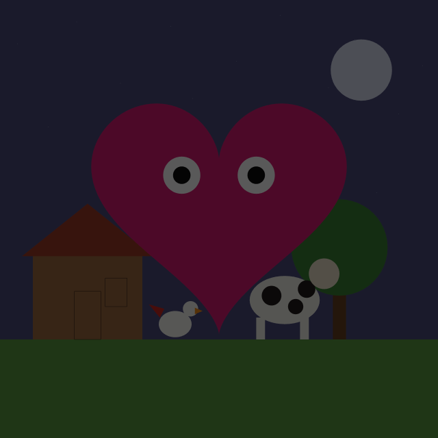
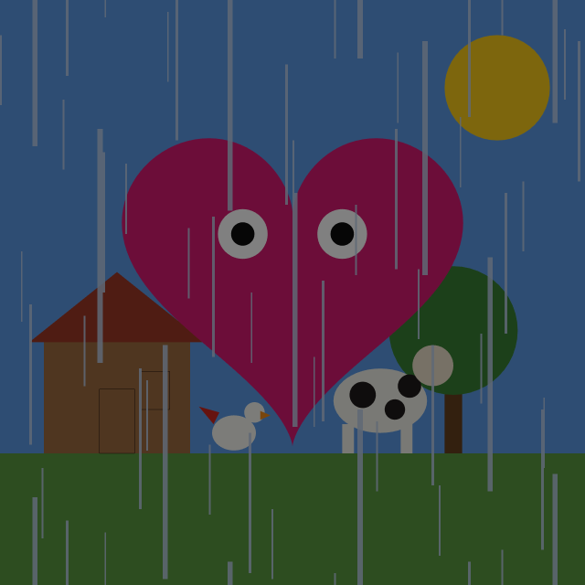
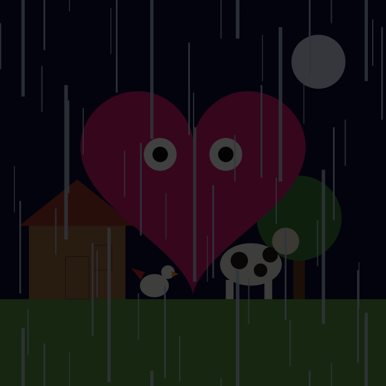

# Relatório — Cena 2D Interativa

**Disciplina:** MCCC007-23 — Computação Gráfica, UFABC  
**Programa:** `06_senhor_coracao.py`  
**Dupla:** Alexandre Hiroyuki (11202230885) e Gabriel Cipriano (11202111302)

O programa desenha um sítio em duas dimensões em torno do Sr. Coração. A janela usa OpenGL 4.0 Core, com GLFW e ModernGL. Não há immediate mode, `glBegin` nem matriz embutida: cada desenho é um VAO e os shaders é que posicionam e colorem.

## 1. Explicação da arquitetura

### 1.1 Papel de cada arquivo

`06_senhor_coracao.py` é o arquivo principal. Ele cria a janela de 640×640, o contexto 4.0 Core com compatibilidade estrita (necessária no macOS), pede quatro amostras por pixel e carrega os dois programas de shader. Em seguida instancia os objetos da cena e entra no laço: calcula o estado do quadro, limpa o fundo, chama `desenhar()` na ordem do pintor, troca os buffers e lê o teclado.

`geometrias.py` não desenha nada. As funções devolvem arranjos NumPy `float32` de vértices `(x, y, z, w)`, com `z = 0` e `w = 1`. `leque` fecha uma curva como `TRIANGLE_FAN`: o primeiro vértice é o centro, a curva vem em seguida e o primeiro ponto da curva se repete no fim. Em cima disso estão o coração, o círculo unitário e a elipse. `quad` e `triangulo` fornecem as peças retas. `quad_tela` cobre o NDC com dois triângulos, só para a chuva.

Cada objeto de cena é uma classe com o mesmo contrato: recebe `ctx` e o programa `prog` no construtor, sobe seus VBOs e VAOs uma vez, implementa `desenhar()` e `liberar()`. Não há herança. A comunicação é pelo programa principal.

- **Astro** guarda um círculo, com cor, posição e escala da instância. O laço chama `desenhar()` do sol ou da lua.
- **Estrelas** guarda dezoito pontos fixos. O laço chama `desenhar()` só de noite.
- **Chao** guarda um retângulo de grama. O laço chama `desenhar()`.
- **Arvore** guarda o tronco, a copa e o índice da paleta. O laço chama `desenhar()` e `ciclar_copa()`.
- **Bangalo** guarda a parede, o telhado, a porta, a janela e a caixa do corpo. O laço chama `desenhar()`, `ciclar_telhado()` e `caixa()`.
- **Vaca** guarda as partes do corpo, um círculo reutilizado e a própria caixa. O laço chama `desenhar()`, `ciclar_manchas()` e `andar(dx, caixa)`.
- **Galinha** guarda o corpo, a cabeça, o bico, o rabo e a própria caixa. O laço chama `desenhar()` e `andar(dx, caixa)`.

O Sr. Coração não virou classe. O corpo e o círculo dos olhos continuam no programa principal, como no exemplo de aula, para o reúso por uniforme ficar visível no laço: um VAO de círculo é desenhado quatro vezes, duas como branco do olho e duas como pupila.

### 1.2 O que muda entre um desenho e outro

A geometria fica na GPU. O que muda é uniforme, escrito antes de cada `render`:

- `u_escala` (`float`) multiplica `xy` do vértice;
- `u_deslocamento` (`vec2`) soma a translação em NDC;
- `u_cor` (`vec4`) segue ao fragmento;
- `u_atenuacao` (`float`) é global do quadro.

Objetos compostos, como a árvore, a vaca, a galinha e o bangalô, guardam as peças em coordenadas locais. Na hora de desenhar, a posição do objeto entra na conta `u_deslocamento = posicao + offset_da_peca`. Mover a vaca é mudar `posicao`: nenhum vértice é reenviado.

A vaca ilustra o reúso. Há um único VAO de círculo. A cabeça e as três manchas são quatro chamadas desse VAO, com escala, deslocamento e cor diferentes. A cor `None` numa parte é um marcador: `desenhar()` troca pelo valor atual de `cor_manchas`. A árvore e o bangalô usam o mesmo marcador para a copa e o telhado.

### 1.3 Ordem de um quadro

1. O par `(noite, chuva)` escolhe o fundo e a atenuação.
2. `ctx.clear` pinta o céu. O céu não é geometria.
3. De dia entra o sol. De noite entram as estrelas e a lua.
4. Chão, árvore, bangalô, vaca e galinha, nessa ordem. Quem vem depois cobre quem veio antes. Não há teste de profundidade.
5. O coração e os olhos, por cima dos animais.
6. Se `chuva` está ligada, um segundo programa cobre a tela com linhas semitransparentes.

A atenuação é escrita uma vez por quadro no programa da cena, e todos os `desenhar()` seguintes a leem. A chuva usa outro programa, ligado a outro VAO. O mesmo número é escrito de novo em `prog_chuva["u_atenuacao"]` dentro de `desenhar_chuva()`. Sem essa segunda escrita, o linker enxergaria um uniforme que ninguém preenche e a chuva não escureceria junto com o resto.

### 1.4 Estado e teclado

O estado global cabe em `olhar_x`, `olhar_y`, `noite`, `chuva` e `atenuacao`. O callback do GLFW só altera esses valores ou chama um método de um objeto. As classes não leem o teclado.

- **D** alterna `noite`.
- **C** alterna `chuva`.
- **Setas** movem a pupila. Esquerda e direita também andam a vaca e a galinha.
- **1, 2 e 3** ciclam o telhado, as manchas da vaca e a copa.
- **ESC** fecha a janela.

A pupila anda dentro do branco do olho. O limite é no módulo do vetor `(olhar_x, olhar_y)`, não em cada eixo: o olho é um círculo, e um limite quadrado deixaria a pupila escapar na diagonal.

### 1.5 Quatro climas

Dois booleanos produzem quatro fundos. A atenuação vale para todo objeto desenhado com o programa da cena, e também para a cor das linhas de chuva.

- **Dia:** fundo `(0.53, 0.78, 0.95)`, atenuação `1.00`, sol no céu.
- **Noite:** fundo `(0.10, 0.10, 0.17)`, atenuação `0.35`, estrelas e lua.
- **Dia com chuva:** fundo `(0.18, 0.30, 0.45)`, atenuação `0.50`, sol e linhas.
- **Noite com chuva:** fundo `(0.01, 0.01, 0.05)`, atenuação `0.25`, estrelas, lua e linhas.

O dia é azul claro de propósito. A galinha e a vaca são quase brancas; num céu cinza-claro elas sumiam. O dia com chuva permanece na mesma família de azul, mais escuro.

### 1.6 Movimento e caixa de colisão

A vaca anda `0.04` por tecla e a galinha `0.07`. As duas ficam na altura do chão (`y = -0.55`) e só mudam `x`. `LIMITE_X` sai da própria caixa do animal, de modo que rabo, bico, corpo e cabeça permaneçam em `[-1, 1]`.

O bangalô publica a caixa do corpo de madeira, não a do telhado. `CAIXA_COLISAO` é o retângulo local `(-0.25, 0.0, 0.25, 0.38)`. `caixa()` soma a posição do bangalô e devolve o retângulo em coordenadas de tela: de `-0.85` a `-0.35` na horizontal, do chão até o topo da parede.

`andar` recebe essa tupla. O animal não importa a classe `Bangalo`. O passo proposto é limitado à tela e, se o retângulo do animal invadir o da casa, `_contornar` o devolve ao lado de onde ele veio, encostado na parede. A invasão usa desigualdade estrita, então encostar não conta como atravessar. Se, depois do limite da tela, o animal ainda estivesse dentro da casa, o passo é descartado e a posição anterior permanece.

## 2. Como os shaders foram pensados

Há dois programas. O da cena serve a todos os objetos. O da chuva existe porque o efeito não está nos vértices: um retângulo cobre a janela e o fragmento decide onde há linha. Um VAO nasce ligado a um programa, por isso a chuva não reutiliza o VAO dos outros objetos.

### 2.1 Cena — `senhor_coracao.vert` e `senhor_coracao.frag`

O vértice está em coordenadas locais, já no intervalo que cabe na janela. Não há matriz de modelo nem correção de aspecto: a janela é quadrada e o NDC coincide com o desenho.

```glsl
gl_Position = vec4(vPosition.xy * u_escala + u_deslocamento, vPosition.zw);
```

`u_cor` sai como `v2fcolor`. O fragmento multiplica só o RGB por `u_atenuacao` e deixa o alfa intacto. Atenuar o alfa mudaria a opacidade, não o brilho. De noite o coração magenta continua opaco, apenas mais escuro. O mesmo vale para a casa, a vaca e a grama.

`gl_PointSize = 4.0` existe para as estrelas, desenhadas com a primitiva `POINTS`. Os dezoito pontos estão no VBO; escala `1` e deslocamento zero os deixam onde foram escritos.

### 2.2 Chuva — `chuva.vert` e `chuva.frag`

O vértice do retângulo já está em NDC. O shader só o copia para `gl_Position` e converte `xy` de `[-1, 1]` para a coordenada de tela `[0, 1]`, chamada `vUv`.

O fragmento não lê uma textura. `camada` fabrica linhas verticais:

- `floor(uv.x * colunas)` numera a coluna. Somar `i * 0.37` dentro do `fract` vertical desfasa as colunas, para que não caiam todas na mesma altura.
- `fract` devolve a parte fracionária em `[0, 1)`. Somar `u_tempo * velocidade` empurra esse ciclo para baixo. Ao passar de `1`, a linha reaparece em cima.
- `step(a, b)` vale `0` quando `b < a` e `1` no resto. `step(fract(uv.x * colunas), 0.08)` liga só os primeiros 8% da coluna: é a espessura. `step(y, comprimento)` liga o trecho do comprimento daquela camada.

Há três chamadas, com comprimentos `0.12`, `0.24` e `0.40` e velocidades `0.45`, `0.70` e `1.00`. A linha curta é a mais lenta. A longa cai mais rápido. O Python só entrega `glfw.get_time()` em `u_tempo`.

A cor `(0.75, 0.82, 0.92)` é multiplicada por `u_atenuacao`, como no Sr. Coração. O alfa é `clamp` da soma das camadas, no máximo `0.85`, e não entra na atenuação: a linha fica mais fraca sem ficar mais transparente. O passo usa blending `SRC_ALPHA, ONE_MINUS_SRC_ALPHA` e o desliga ao terminar, para não alterar os objetos opacos do quadro seguinte.

### 2.3 Primitivas

O enunciado pede mais de um tipo. A cena usa quatro:

- `TRIANGLE_FAN` — coração, círculos, elipses, chão, parede, tronco, patas e copa;
- `TRIANGLES` — telhado, bico, rabo e o retângulo da chuva;
- `LINE_LOOP` — porta e janela, no mesmo `quad` que, com `TRIANGLE_FAN`, seria uma área;
- `POINTS` — estrelas.

## 3. Capturas de tela

As figuras abaixo foram geradas pela mesma sequência de desenho do programa, nos quatro estados. O modo dia e o modo noite são os dois primeiros. A chuva aparece nos dois seguintes para mostrar o segundo shader e a atenuação.

### Modo dia

Céu `(0.53, 0.78, 0.95)`, atenuação `1`, sol aceso, animais na cor cheia.



### Modo noite

Céu `(0.10, 0.10, 0.17)`, atenuação `0.35`, lua e estrelas no lugar do sol. O coração, a casa e os animais escurecem sem mudar o alfa.



### Dia com chuva e noite com chuva

À esquerda, dia com chuva: fundo `(0.18, 0.30, 0.45)` e atenuação `0.50`. À direita, noite com chuva: fundo `(0.01, 0.01, 0.05)` e atenuação `0.25`. As linhas são as mesmas; o que muda é o brilho.





## 4. Divisão de tarefas

**Alexandre Hiroyuki — código**

- Janela GLFW, contexto OpenGL 4.0 Core, laço de quadro, Sr. Coração e movimento da pupila com limite circular.
- Estados de dia, noite e chuva: os quatro fundos e o uniforme `u_atenuacao`.
- Programa da chuva (`chuva.vert`, `chuva.frag`), o retângulo em `TRIANGLES`, o blending e a passagem de `u_tempo`. Inclusão de `u_atenuacao` também nesse programa, para as linhas escurecerem como o restante da cena.
- Céu de dia em azul claro e céu de dia com chuva mais escuro, para os animais brancos não se confundirem com o fundo.
- Deslocamento da vaca e da galinha, com passos `0.04` e `0.07`, limite da tela e caixa de colisão do bangalô (`CAIXA_COLISAO`, `caixa()`, `_invade` e `_contornar`).

**Alexandre Hiroyuki — relatório**

- Redação deste documento: arquitetura, contrato entre as classes, descrição dos dois shaders e das capturas.
- Itens 1 a 5 e 10 a 15 do relatório resumido em `README.md`.

**Gabriel Cipriano — código**

- Refatoração em objetos: `geometrias.py`, `Astro`, `Estrelas`, `Chao`, `Arvore`, `Bangalo`, `Vaca` e `Galinha`.
- Inclusão desses objetos no laço, com sol de dia e lua mais estrelas de noite.
- Reúso do círculo unitário no sol, na lua, na copa, na cabeça e nas manchas da vaca e na cabeça da galinha.
- Primitivas que o exemplo original não tinha: `TRIANGLES` no telhado, no bico e no rabo; `LINE_LOOP` na porta e na janela; `POINTS` nas estrelas, com `gl_PointSize` no vértice.
- Paletas de cor e as teclas 1, 2 e 3, que chamam `ciclar_telhado`, `ciclar_manchas` e `ciclar_copa`.

**Gabriel Cipriano — relatório**

- Itens 6 a 9 do relatório resumido em `README.md`, descrevendo o sol reutilizado, a refatoração, a cena do sítio e o ciclo de cores.

## 5. Declaração de uso de IA

Eu, Alexandre Hiroyuki, utilizei IA para auxiliar na organização do relatório a partir dos nossos próprios registros. Revisamos o material e assume a responsabilidade técnica e intelectual pelo código e pelo texto, inclusive por erros ou escolhas de arquitetura.
