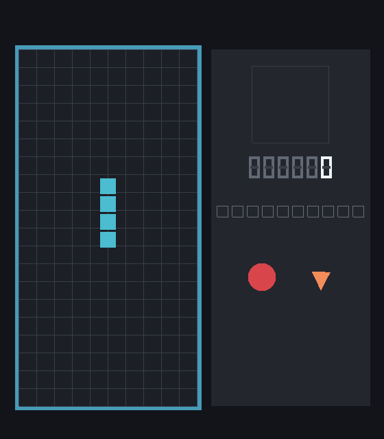
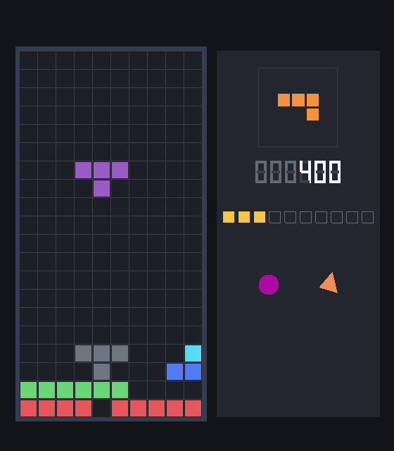
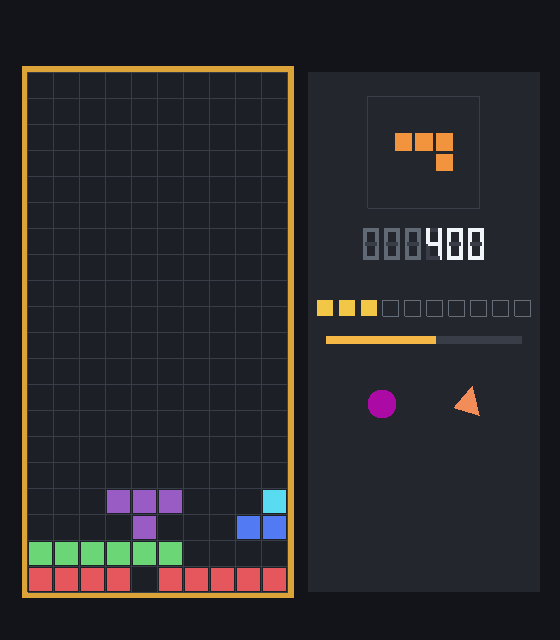
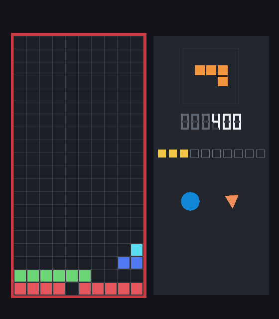
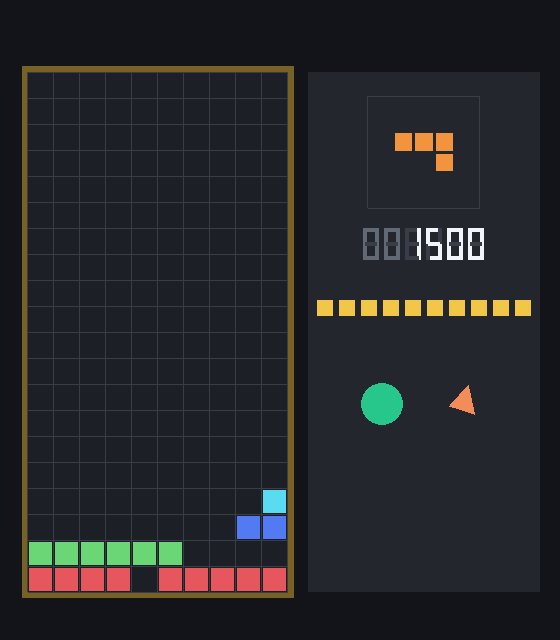

# Relatório — Jogo 2D Animado

**Disciplina:** MCCC007-23 — Computação Gráfica, UFABC  
**Programa:** `tetris.py`  
**Aluno:** Alexandre Hiroyuki (11202230885)

O programa é um Tetris simplificado. A peça cai, encaixa na pilha, completa linhas e a partida termina em vitória, ao fechar 10 linhas, ou em derrota, quando a próxima peça nasce dentro da pilha. A janela usa OpenGL 4.0 Core, com GLFW e ModernGL. Não há immediate mode, `glBegin` nem matriz embutida: cada desenho é um VAO e os shaders é que posicionam e colorem.

A base é o exemplo “Acerte o alvo”, no shader `shaders/acerte_o_alvo.vert`, e o laço de `07_triangulo_animado.py`, que já carrega esse shader para comparar movimento por quadro e movimento por tempo. O jogo não edita esses dois arquivos. Ele os expande em `shaders/tetris.vert`, `shaders/tetris.frag` e `tetris.py`.

## 1. Explicação da arquitetura

### 1.1 O que a base já fazia

`acerte_o_alvo.vert` recebe um vértice e dois uniforms. `u_escala` é um `float` e multiplica `xy`. `u_deslocamento` é um `vec2` e soma a translação. A cor não é uniforme: sai do atributo `vColors`, gravado no VBO.

```glsl
gl_Position = vec4(vPosition.xy * u_escala + u_deslocamento, vPosition.zw);
v2fcolor = vColors;
```

`07_triangulo_animado.py` cria a janela, o contexto 4.0 Core, um programa de shader e dois VBOs de triângulo, um vermelho e um verde, porque a cor está no vértice. O laço mede `dt` com `glfw.get_time()`. Um triângulo anda `PASSO` por quadro. O outro anda `VELOCIDADE * dt`, em unidades por segundo. A tecla `V` chama `glfw.swap_interval`. A cada meio segundo o título mostra o vsync e o fps. No fim, VAOs, VBOs e o programa são liberados.

O exemplo existe para mostrar que o passo por quadro muda de velocidade quando o vsync liga ou desliga. O passo por tempo não muda.

### 1.2 O que o jogo conserva e o que ele troca

`tetris.py` conserva o arranque: callback de erro do GLFW antes de `glfw.init`, contexto 4.0 Core, `OPENGL_FORWARD_COMPAT`, `swap_interval(1)`, leitura do shader em arquivo, malha criada uma vez, uniforms escritos antes de cada `render`, `V` no vsync, fps no título e `liberar()` no encerramento.

O ramo `x += PASSO` não entrou no jogo. Toda queda, repetição de tecla, trava, limpeza de linha, pulso e rotação usam tempo, como o triângulo verde. Entrou um limite que o exemplo não tinha: se `dt` passa de `0.05` s, ele é cortado. Arrastar a janela não faz a peça atravessar o poço.

A cor saiu do VBO. No exemplo, duas cores exigiam dois buffers. Aqui o mesmo quadrado vira célula ciano, célula roxa, segmento de dígito e moldura. A cor vai em `u_cor`, escrita antes do `render`. É o que o enunciado pede: posição, escala e cor por uniforme, sem regravar o VBO a cada quadro.

`u_escala` deixou de ser `float` e virou `vec2`. A janela do exemplo podia tratar x e y com o mesmo fator. A deste jogo é 560×640. Um fator só esticaria a célula. `tam_ndc(largura, altura)` converte o tamanho em pixels para os dois eixos do NDC, e a célula continua quadrada na tela.

### 1.3 Papel de cada arquivo e de cada classe

`shaders/tetris.vert` e `shaders/tetris.frag` são o único programa. Não há segundo shader: o efeito de brilho cabe num uniforme, ao contrário da chuva da atividade 2, que precisava de outro programa.

`tetris.py` concentra o jogo. Quatro classes se falam numa direção só. Nenhuma desenha e aplica regra ao mesmo tempo.

- **Peca** guarda tipo, coluna, linha e rotação. `celulas()` soma os blocos locais de `BLOCOS` à posição. Não conhece OpenGL nem teclado.
- **Partida** guarda a grade 10×20, o saco de peças, a pontuação, as linhas, a fração de queda, o repouso e a limpeza. Recebe `dt` e devolve o que mudou. Não cria buffer e não lê tecla.
- **Desenhista** sobe três VAOs no construtor: quadrado, triângulo e círculo. `malha()` escreve os uniforms e chama `render`. `liberar()` solta os buffers e o programa.
- **Jogo** é o único que vê a janela. Mede o tempo, lê o teclado, chama `Partida` e, no fim do quadro, chama `Desenhista`. As regras não importam GLFW. O desenho não importa a regra, só lê a grade e a peça que `Jogo` já atualizou.

`07_triangulo_animado.py` fazia isso tudo no corpo do módulo: criar a janela, medir `dt`, mover e desenhar. A divisão em classes separa o que o exemplo mantinha junto, porque o Tetris tem estado de partida, estado de tela e geometria reutilizada. O contrato continua o do exemplo: a geometria nasce uma vez, o quadro só muda uniforme.

### 1.4 O que muda entre um desenho e outro

Há três malhas. O quadrado unitário, de -0,5 a 0,5, vira poço, célula, fantasma, segmento do placar, marca de linha e barra de cooldown. O círculo, também no mesmo intervalo, pulsa no painel. O triângulo gira no painel. Nenhum `glBufferSubData` ocorre dentro do laço.

Antes de cada `render`, `Desenhista.malha` escreve:

- `u_escala` (`vec2`), tamanho em NDC;
- `u_deslocamento` (`vec2`), centro em NDC;
- `u_rotacao` (`float`), em radianos, zero em tudo que não é o triângulo;
- `u_cor` (`vec4`);
- `u_brilho` (`float`), 1 na maior parte dos desenhos.

A peça ativa é quatro chamadas do mesmo quadrado. A próxima peça, no painel, são outras quatro, com outra escala. O fantasma reutiliza o mesmo VAO com alfa 0,45. O dígito é o mesmo quadrado de novo, uma vez por segmento aceso ou apagado.

### 1.5 Ordem de um quadro

1. `ctx.clear` pinta o fundo `(0.07, 0.08, 0.10)`. O fundo não é geometria.
2. A moldura do poço, um retângulo um pouco maior, na cor do estado.
3. O retângulo do poço e a grade: cada célula é um `LINE_LOOP` do quadrado.
4. As células ocupadas da grade. Se a linha está sendo limpa, `u_brilho` pisca.
5. O fantasma e a peça ativa, ou, na abertura, a peça que oscila no centro.
6. O painel: caixa da próxima peça, seis dígitos, dez marcas, a barra se houver cooldown, o círculo e o triângulo.

Não há teste de profundidade. Quem é desenhado depois cobre quem veio antes. O blending `SRC_ALPHA, ONE_MINUS_SRC_ALPHA` fica ligado o tempo todo. Os objetos opacos usam alfa 1, então o blending não os altera. O fantasma é o único que depende dele.

### 1.6 Estado e teclado

Há quatro estados: `inicio`, `jogando`, `pausado` e `fim`. O fim ainda distingue `vitoria` e `derrota`. `R` cria outra `Partida` sem fechar a janela. Enter faz o mesmo a partir do início ou do fim.

O exemplo só tinha callback, e só para `ESC` e `V`. O enunciado separa o contínuo do discreto, e o jogo segue essa divisão.

O callback trata o que acontece uma vez por toque: Enter, `R`, `P`, seta para cima, `Z`, espaço, `V` e `ESC`. A rotação e a queda instantânea não podem repetir com o segurar da tecla. O callback só age em `glfw.PRESS`, então o repeat do sistema, que chega como `REPEAT`, é ignorado.

`glfw.get_key` trata o que continua enquanto a tecla está segurada. Esquerda e direita movem uma célula na hora e, depois de 0,17 s, repetem a cada 0,05 s. As duas juntas se anulam. Baixo troca a velocidade de queda pela queda suave, de 12 células por segundo.

`Partida` não vê essas teclas. `Jogo` traduz cada uma numa chamada: `mover`, `girar`, `derrubar` ou `atualizar(dt, suave)`.

## 2. Laço de jogo e animação

O laço de `07_triangulo_animado.py` cabe em quatro linhas: ler o relógio, subtrair o instante anterior, avançar o triângulo do tempo com `VELOCIDADE * dt` e guardar o instante. `Jogo.rodar` é essa conta, com o corte de `dt` e a pausa.

```text
agora = glfw.get_time()
dt = min(agora - anterior, 0.05)
anterior = agora
```

`anterior` é atualizado em todo quadro, inclusive na pausa. O tempo em que o jogo ficou parado não entra no `dt` do quadro seguinte: esse `dt` é só o intervalo desde o último quadro, já cortado em 0,05 s. Sem essa atualização, o primeiro quadro depois da pausa receberia a duração inteira da pausa.

Na pausa, `tempo_cena` não soma `dt` e `Partida.atualizar` não é chamada. A peça não cai, a limpeza não termina, o círculo não troca de cor e o triângulo não gira. O desenho continua, senão a janela não se redesenharia, e o título continua a mostrar o fps, que é medido com o relógio real, não com `tempo_cena`.

Fora da pausa, `tempo_cena` anda. Ele não move a grade. Move o que é autônomo:

- o triângulo do painel gira a `1,15` radiano por segundo (`GIRO * tempo_cena` em `u_rotacao`);
- o círculo muda de cor e de diâmetro com `sin` do mesmo relógio;
- a próxima peça pulsa de escala;
- a peça ativa varia `u_brilho`;
- na abertura, uma peça no centro do poço troca de forma e sobe e desce.

Nada disso usa o passo por quadro do triângulo vermelho. A velocidade continua a mesma com o vsync ligado ou desligado, porque o avanço é `velocidade * dt`. A tecla `V` só muda `glfw.swap_interval`. O título mostra `vsync on` ou `vsync OFF` e o fps, como no exemplo, e acrescenta o que o exemplo não precisava dizer: estado, pontos, linhas e o cooldown (`queda`, `suave`, `trava` ou `limpa`).

A queda da peça usa a mesma forma do triângulo verde, em células por segundo. No nível 0 a velocidade é 1,35. Sobe 0,40 a cada duas linhas e para em 8. A fração acumulada é o deslocamento que ainda não virou célula:

```text
fracao += velocidade * dt
enquanto fracao >= 1:
    fracao -= 1
    desce uma célula, ou para
```

A queda suave soma um ponto por célula descida. A queda instantânea, no espaço, também desce uma célula por iteração e soma dois pontos por célula. Ela não é uma velocidade: é uma ação discreta que esgota o caminho até o chão.

## 3. Colisões

Cada bloco da peça e cada célula da grade é um retângulo alinhado aos eixos, do tamanho de uma célula. Não há círculo na colisão. O círculo da tela é só decoração.

`_colide` percorre os quatro blocos da rotação pedida. A posição candidata bate se a coluna está fora de 0…9, se a linha está fora de 0…19, ou se a grade naquela casa já tem peça. Parede, teto e chão são o mesmo teste: sair do retângulo do poço conta como ocupado.

O túnel seria a peça, num `dt` grande, saltar de uma linha livre para outra linha livre com um bloco no meio. O jogo não dá esse salto. O `while` só avança uma célula quando a de baixo está livre, e interrompe na primeira ocupada. O corte de `dt` em 0,05 s limita quantas células um quadro pode pedir. Mesmo sem o corte, a peça pararia no bloco: o corte existe para ela também não cair um poço vazio inteiro durante um travamento da janela. Esquerda, direita e a queda instantânea usam o mesmo passo de uma célula.

O fantasma é esse laço sem mover a peça de verdade: a linha desce até a primeira colisão e o desenho usa essa linha. Se ela é a linha atual, não há fantasma.

A rotação tenta a nova orientação no lugar e, se bater, tenta deslocamentos de uma ou duas colunas e de uma linha. Cada tentativa passa por `_colide`. Não há rotação que atravesse uma parede sem um teste.

Quando a peça não consegue descer, começa o repouso. Ele só soma `dt` nos quadros em que ela não desceu. O `dt` da queda que a fez encostar não entra na trava: um pico de tempo não cravaria a peça no mesmo quadro em que ela aterrissou. Aos 0,50 s ela é copiada para a grade. Mover ou girar com sucesso zera o repouso, no máximo 12 vezes, para a peça não ficar suspensa para sempre. A barra do painel mostra a fração que ainda falta. Durante a pausa essa fração congela, porque `atualizar` não roda.

Linhas cheias não somem no quadro da trava. Ficam 0,30 s piscando e só então saem. As de cima descem um lugar por linha removida. Uma linha vale 100 pontos, duas 300, três 500 e quatro 800. Na décima linha o resultado é vitória e nenhuma peça nova nasce. Se a peça nova já nasce em colisão, o resultado é derrota.

## 4. Como os shaders foram pensados

Há um programa. O vértice posiciona. O fragmento só ajusta o brilho. A decisão de qual primitiva usar fica no Python: o mesmo VAO do quadrado é desenhado com `TRIANGLE_FAN` ou com `LINE_LOOP`.

### 4.1 De `acerte_o_alvo.vert` para `tetris.vert`

A conta do exemplo, com rotação zero, continua valendo. A escala é aplicada primeiro, a rotação em torno da origem do vértice vem depois, e o deslocamento entra por último. Assim o triângulo gira no próprio centro e a célula, com `u_rotacao = 0`, só anda e muda de tamanho.

```glsl
vec2 p = vPosition.xy * u_escala;
vec2 girado = vec2(c * p.x - s * p.y, s * p.x + c * p.y);
gl_Position = vec4(girado + u_deslocamento, 0.0, 1.0);
v2fcolor = u_cor;
```

`vColors` saiu. Um VBO com cor gravada não serve para o mesmo quadrado em sete cores de peça, no dígito aceso e no dígito apagado. `u_cor` ocupa esse lugar e segue ao fragmento como `v2fcolor`, o mesmo nome de saída do exemplo.

A rotação não está na grade. A peça gira trocando a lista de blocos em `BLOCOS`, ainda em coordenadas de célula, e cada bloco é um quadrado sem rotação. `u_rotacao` existe para o triângulo do painel, que é a animação autônoma pedida pelo enunciado e que o shader da base não expressava.

### 4.2 `tetris.frag`

O fragmento do exemplo só precisava escrever a cor interpolada. Aqui ela ainda chega em `v2fcolor`, e o RGB é multiplicado por `u_brilho`. O alfa não entra na conta.

```glsl
outfragcolor = vec4(v2fcolor.rgb * u_brilho, v2fcolor.a);
```

É o mesmo critério da atenuação do Sr. Coração: escurecer não pode deixar o objeto transparente. O fantasma já traz o alfa na cor. A peça ativa usa o brilho para pulsar. A linha que está sendo apagada também. O resto desenha com brilho 1.

### 4.3 Primitivas

O enunciado pede mais de um tipo. O jogo usa três, nas mesmas malhas:

- `TRIANGLE_FAN` no quadrado, nas células, no poço, nos dígitos e no círculo;
- `TRIANGLES` no triângulo que gira;
- `LINE_LOOP` no mesmo quadrado, para a grade, a caixa da próxima peça e a marca de linha ainda vazia.

## 5. Capturas de tela

As figuras foram geradas pela mesma sequência de desenho do programa. O título, que no jogo mostra o estado e o cooldown, não aparece nestes recortes: ele fica na barra da janela.

### Início

Moldura ciano, poço vazio, placar em zero e as dez marcas apagadas. A peça no centro oscila com o tempo. O círculo e o triângulo já se movem. Enter começa a partida.



### Em andamento

A peça cai sobre a pilha. O fantasma, em cinza, marca onde ela vai parar. O placar marca 400 pontos e três linhas. A próxima peça está na caixa. A moldura volta ao cinza do jogo.



### Pausa

A mesma partida, com a moldura âmbar e a barra de trava visível. Enquanto `P` não é apertado de novo, a peça, a barra, o círculo e o triângulo ficam no quadro em que a pausa começou. O `dt` desse intervalo não é somado depois.



### Fim de jogo

À esquerda, derrota: a moldura fica vermelha e não há peça ativa, porque a próxima não coube. À direita, vitória: a moldura fica dourada, as dez marcas fecham e o placar mostra os pontos da partida. `R` ou Enter abrem outra partida sem fechar o programa. O círculo e o triângulo continuam animados, porque o fim não é pausa: o que congela é a grade.





## 6. Divisão de tarefas

A atividade foi feita individualmente por Alexandre Hiroyuki: o jogo, os shaders, as capturas e este relatório.

## 7. Declaração de uso de IA

Eu, Alexandre Hiroyuki, utilizei IA para auxiliar na organização do relatório a partir dos meus próprios registros. Revisei o material e assumo a responsabilidade técnica e intelectual pelo código e pelo texto, inclusive por erros ou escolhas de arquitetura.

